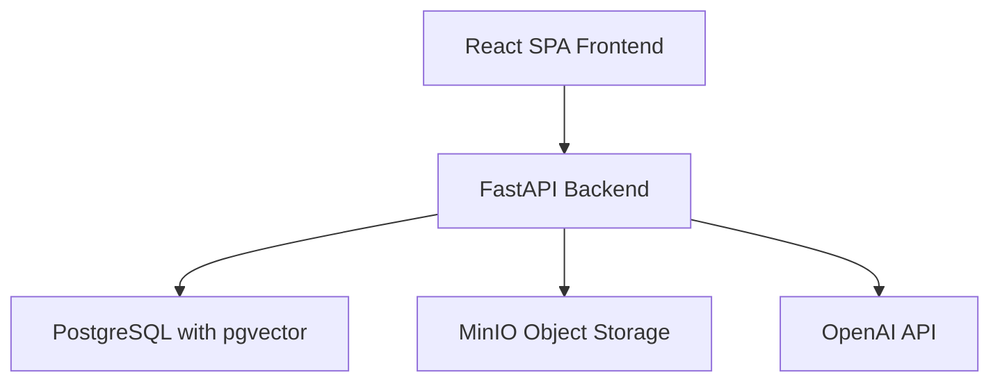
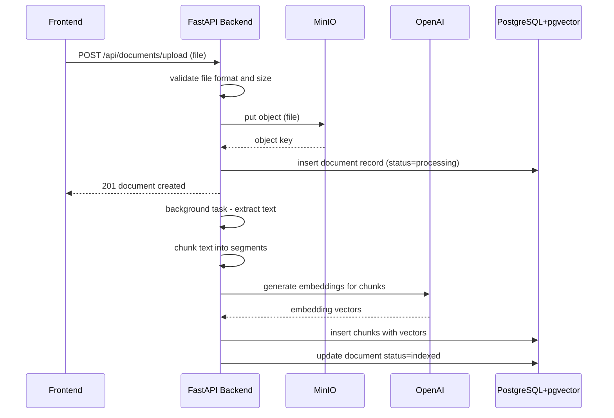
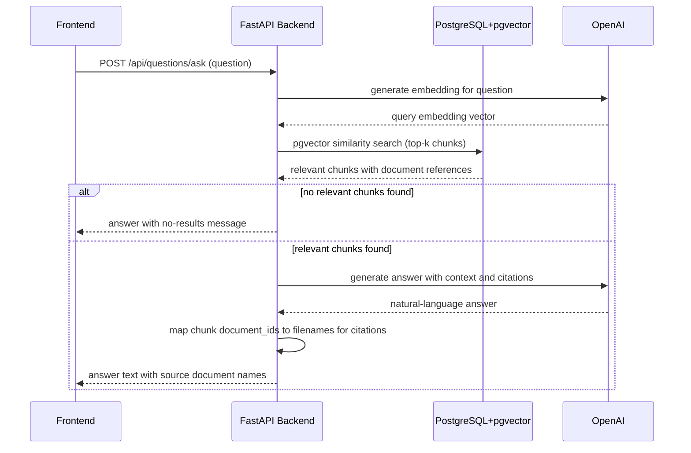
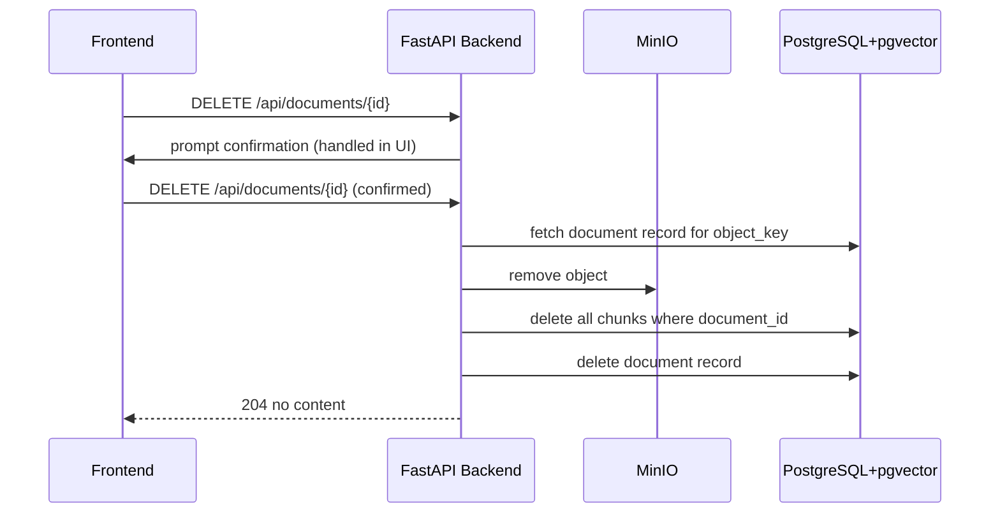
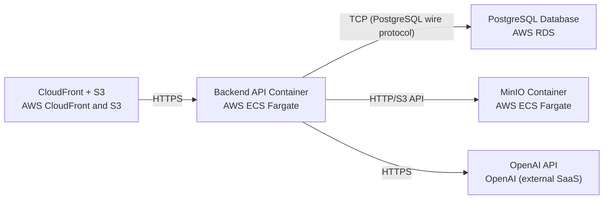

# Architecture

> Maintained by QuorQ AI SDLC. Text between `sdlc:auto` markers is regenerated; anything outside them is yours and is kept.

<!-- sdlc:auto:start narrative -->
## Overview

_No entries for this phase yet._
<!-- sdlc:auto:end narrative -->

<!-- sdlc:auto:start building-blocks -->
## Building Block View

| ID | Name | Technology | Responsibility | Depends on |
|---|---|---|---|---|
| frontend | React SPA Frontend | React 19 | Provides the admin document upload and library management UI and the employee question-answering interface. Communicates with the backend API over HTTPS. No authentication layer. | backend_api |
| backend_api | FastAPI Backend | FastAPI 0.115 | Exposes REST endpoints for document upload, library CRUD, and question answering. Handles file validation, orchestrates text extraction and chunking, calls OpenAI for embeddings and answer generation, queries pgvector for similarity search, and manages MinIO object lifecycle. | database, object_storage, ai_provider |
| database | PostgreSQL with pgvector | PostgreSQL 16 | Stores document metadata (filename, format, size, upload timestamp, indexing status) and document chunks with their text and vector embeddings. Provides similarity search via pgvector. | — |
| object_storage | MinIO Object Storage | MinIO | Stores uploaded original document files (PDF, DOCX, TXT, Markdown) durably for retrieval, reprocessing, and lifecycle management. | — |
| ai_provider | OpenAI API | OpenAI | Generates text embeddings for document chunks and user questions, and generates natural-language answers with citations from retrieved context using a GPT-4-class model. | — |

<!-- sdlc:auto:end building-blocks -->

<!-- sdlc:auto:start runtime -->
## Runtime View

### Document Upload and Indexing

Admin selects a supported file, the backend validates it, stores it in MinIO, creates a document record, then asynchronously extracts text, chunks it, generates embeddings via OpenAI, and stores chunks with vectors in pgvector.

- **Components:** frontend, backend_api, object_storage, ai_provider, database
- **Modules:** routers.documents, services.storage, services.text_extraction, services.chunking, services.embeddings, models.document, models.chunk
- **Key functions:** upload_document(file: UploadFile) -> DocumentResponse, validate_file(file: UploadFile) -> bool, store_in_minio(file, object_key) -> str, extract_text(file_format, file_path) -> str, chunk_text(text, chunk_size, overlap) -> list[str], generate_embeddings(chunks: list[str]) -> list[vector], store_chunks(document_id, chunks, embeddings) -> void, index_document(document_id: UUID) -> void

### Question Answering with Citations

Employee submits a natural-language question. The backend embeds the question, performs pgvector similarity search to retrieve relevant chunks, sends the context to OpenAI for answer generation, and returns the answer with source document citations.

- **Components:** frontend, backend_api, database, ai_provider
- **Modules:** routers.questions, services.embeddings, services.retrieval, services.answer_generation, models.chunk
- **Key functions:** ask_question(question: str) -> AnswerResponse, generate_query_embedding(question: str) -> vector, similarity_search(query_embedding, top_k) -> list[ChunkResult], generate_answer(question, retrieved_chunks) -> AnswerWithCitations, extract_citations(retrieved_chunks) -> list[str]

### Document Deletion

Admin confirms deletion of a document. The backend removes the file from MinIO, deletes all associated chunk embeddings from pgvector, and removes the document metadata record.

- **Components:** frontend, backend_api, object_storage, database
- **Modules:** routers.documents, services.storage, models.document, models.chunk
- **Key functions:** delete_document(document_id: UUID) -> void, remove_from_minio(object_key: str) -> void, delete_chunks_by_document(document_id: UUID) -> void, delete_document_record(document_id: UUID) -> void

<!-- sdlc:auto:end runtime -->

<!-- sdlc:auto:start deployment-view -->
## Deployment View

| Name | Service | Runtime | Scaling | Environment |
|---|---|---|---|---|
| CloudFront + S3 | AWS CloudFront and S3 | Static hosting | CloudFront edge-cached, S3 automatically scales | dev |
| Backend API Container | AWS ECS Fargate | FastAPI 0.115 on Python 3.12 | Single task for pilot, autoscaling ready | dev |
| MinIO Container | AWS ECS Fargate | bitnamilegacy/minio:2024.10.13 | Single task with EBS-backed storage | dev |
| PostgreSQL Database | AWS RDS | PostgreSQL 16 with pgvector extension | Single db.t3.medium instance for pilot | dev |
| OpenAI API | OpenAI (external SaaS) | Cloud-hosted | Provider-managed | dev |

| Source | Target | Protocol |
|---|---|---|
| CloudFront + S3 | Backend API Container | HTTPS |
| Backend API Container | PostgreSQL Database | TCP (PostgreSQL wire protocol) |
| Backend API Container | MinIO Container | HTTP/S3 API |
| Backend API Container | OpenAI API | HTTPS |

<!-- sdlc:auto:end deployment-view -->

<!-- sdlc:auto:start decisions -->
## Architecture Decisions

| Layer | Choice | ADR |
|---|---|---|
| Frontend | React 19 | [ADR-0001](adr/frontend.md) |
| Backend | FastAPI 0.115 | [ADR-0002](adr/backend.md) |
| Database | PostgreSQL 16 | [ADR-0003](adr/database.md) |
| Cloud | AWS | [ADR-0004](adr/cloud.md) |
<!-- sdlc:auto:end decisions -->

<!-- sdlc:auto:start links -->
## Related Documents

- [Data Model](data-model.md)
- [API Specification](api/openapi.yaml)
- [Architecture Decision Records](adr/README.md)
<!-- sdlc:auto:end links -->
