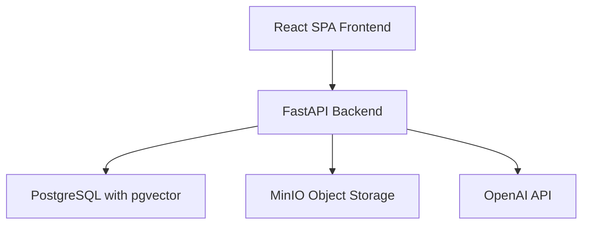
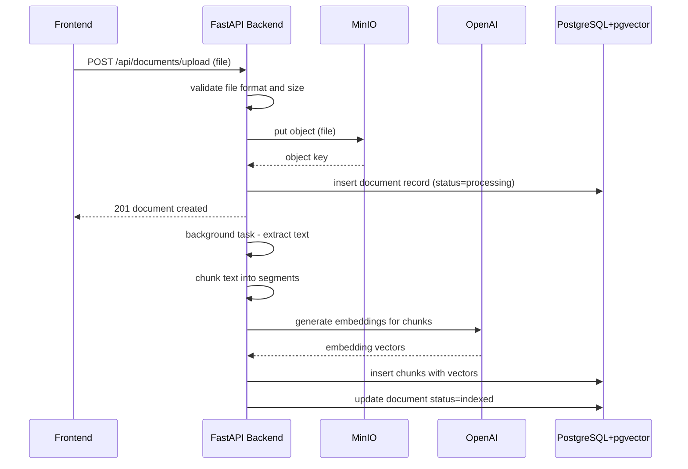
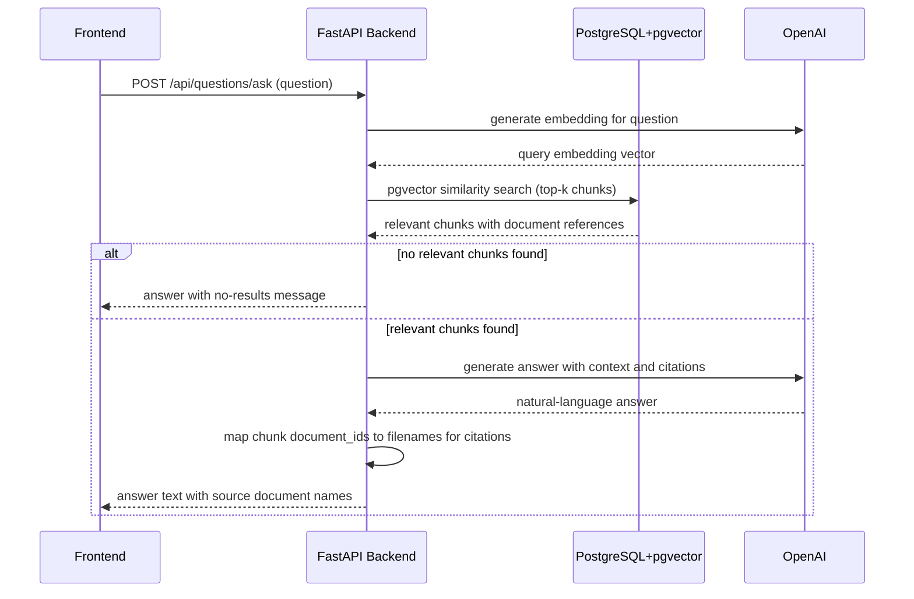
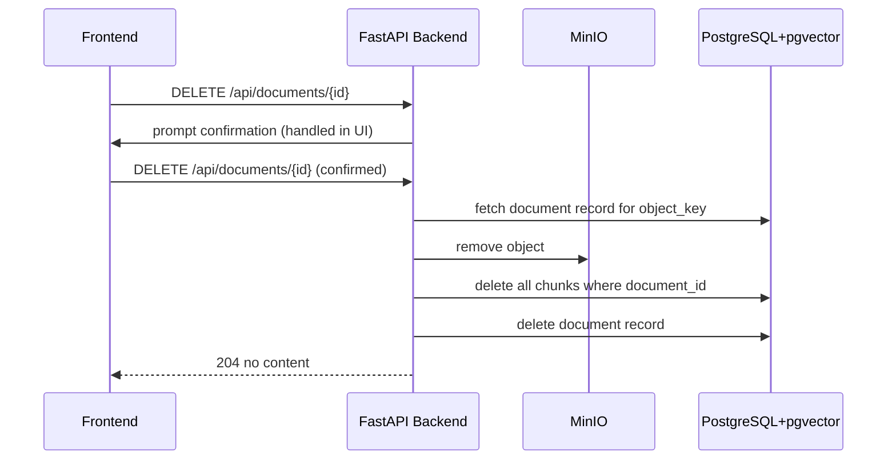
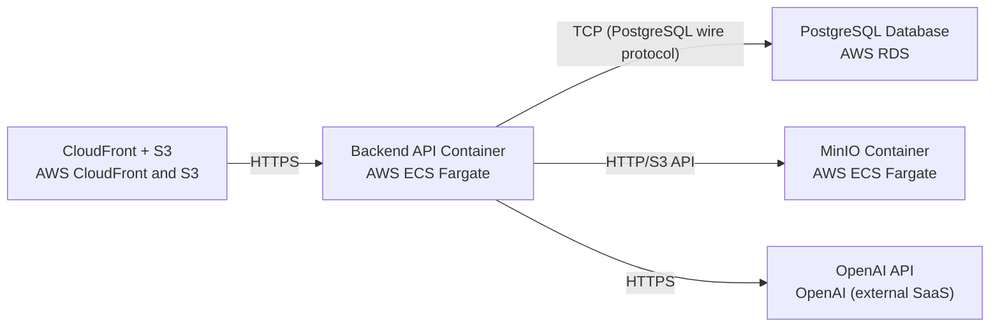

# Architecture

> Maintained by QuorQ AI SDLC. Text between `sdlc:auto` markers is regenerated; anything outside them is yours and is kept.

<!-- sdlc:auto:start narrative -->
## Overview

### ARCH-001 · approved · source: architecture:version-1

Overall architecture for the RAG app pilot, approved at version 1. Admins upload company documents that are stored in MinIO, processed for text extraction and chunking, embedded via OpenAI, and indexed in PostgreSQL with pgvector. Employees ask natural-language questions through a React web interface and receive AI-generated answers with source-document citations. No authentication is required for the pilot. Everything deploys on AWS.

Status: approved. Version: 1. The system is a lightweight Retrieval-Augmented Generation application. Document formats supported: PDF, DOCX, TXT, Markdown. Architecture has five components, three critical paths, two data entities, five REST endpoints, five deployment nodes, and four technology decisions. The frontend is React 19, backend is FastAPI 0.115, database is PostgreSQL 16 with pgvector, object storage is MinIO, AI provider is OpenAI. All deployment targets AWS (CloudFront+S3, ECS Fargate, RDS). No authentication layer is included in the pilot.

**Related:** US-001, US-002, US-003, US-004, US-005, US-006, US-007, US-008, US-009, US-010, US-011, US-012, US-013, US-014

### ARCH-COMP-01 · approved · source: architecture:version-1:components:frontend

React 19 SPA frontend providing admin document upload/library management UI and employee question-answering interface. Communicates with backend over HTTPS. No authentication layer.

Component: frontend. Technology: React 19. Provides the admin document upload and library management UI and the employee question-answering interface. Communicates with the backend API over HTTPS. No authentication layer is included for the pilot.

**Related:** ARCH-001, ARCH-TECH-01

### ARCH-COMP-02 · approved · source: architecture:version-1:components:backend_api

FastAPI 0.115 backend exposing REST endpoints for document upload, library CRUD, and question answering. Handles file validation, text extraction/chunking orchestration, OpenAI calls for embeddings and answer generation, pgvector similarity search, and MinIO object lifecycle management.

Component: backend_api. Technology: FastAPI 0.115. Exposes REST endpoints for document upload, library CRUD, and question answering. Responsibilities: file validation, orchestration of text extraction and chunking, calling OpenAI for embeddings and answer generation, querying pgvector for similarity search, and managing MinIO object lifecycle.

**Related:** ARCH-001, ARCH-TECH-02, ARCH-COMP-03, ARCH-COMP-04, ARCH-COMP-05

### ARCH-COMP-03 · approved · source: architecture:version-1:components:database

PostgreSQL 16 with pgvector extension storing document metadata and document chunks with text and vector embeddings. Provides similarity search via pgvector.

Component: database. Technology: PostgreSQL 16 with pgvector. Stores document metadata (filename, format, size, upload timestamp, indexing status) and document chunks with their text and vector embeddings. Provides similarity search via pgvector extension. Combines relational data and vector storage in a single database, avoiding a separate vector service.

**Related:** ARCH-001, ARCH-TECH-03, ARCH-ENT-01, ARCH-ENT-02

### ARCH-COMP-04 · approved · source: architecture:version-1:components:object_storage

MinIO object storage for durable storage of original uploaded document files (PDF, DOCX, TXT, Markdown). Supports retrieval, reprocessing, and lifecycle management.

Component: object_storage. Technology: MinIO. Stores uploaded original document files (PDF, DOCX, TXT, Markdown) durably for retrieval, reprocessing, and lifecycle management.

**Related:** ARCH-001, ARCH-NODE-03

### ARCH-COMP-05 · approved · source: architecture:version-1:components:ai_provider

OpenAI API as external AI provider. Generates text embeddings for document chunks and user questions, and generates natural-language answers with citations from retrieved context using a GPT-4-class model.

Component: ai_provider. Technology: OpenAI API. Two roles: (1) generates text embeddings for document chunks and user questions; (2) generates natural-language answers with citations from retrieved context using a GPT-4-class model.

**Related:** ARCH-001, ARCH-NODE-05

- ⚠ Specific OpenAI model name/version not identified beyond 'GPT-4-class model'.

### ARCH-PATH-01 · approved · source: architecture:version-1:critical_paths:document_upload_indexing

Critical path: Document Upload and Indexing. Admin selects a supported file, backend validates it, stores it in MinIO, creates a document record, then asynchronously extracts text, chunks it, generates embeddings via OpenAI, and stores chunks with vectors in pgvector.

Path: Document Upload and Indexing. Steps: (1) Admin selects a supported file. (2) Backend validates the file format and size. (3) Backend stores the file in MinIO. (4) Backend creates a document metadata record. (5) Asynchronous background process extracts text from the file. (6) Text is chunked. (7) Embeddings are generated via OpenAI. (8) Chunks with vector embeddings are stored in pgvector.

**Related:** ARCH-001, ARCH-COMP-02, ARCH-COMP-03, ARCH-COMP-04, ARCH-COMP-05, ARCH-END-01

### ARCH-PATH-02 · approved · source: architecture:version-1:critical_paths:question_answering_citations

Critical path: Question Answering with Citations. Employee submits a natural-language question. Backend embeds the question, performs pgvector similarity search to retrieve relevant chunks, sends context to OpenAI for answer generation, and returns the answer with source document citations.

Path: Question Answering with Citations. Steps: (1) Employee submits a natural-language question. (2) Backend embeds the question via OpenAI. (3) Backend performs pgvector similarity search to retrieve relevant chunks. (4) Backend sends retrieved context to OpenAI for answer generation. (5) Backend returns the AI-generated answer with source document citations. Each request is independent with no conversation history.

**Related:** ARCH-001, ARCH-COMP-02, ARCH-COMP-03, ARCH-COMP-05, ARCH-END-05

### ARCH-PATH-03 · approved · source: architecture:version-1:critical_paths:document_deletion

Critical path: Document Deletion. Admin confirms deletion, backend removes the file from MinIO, deletes all associated chunk embeddings from pgvector, and removes the document metadata record.

Path: Document Deletion. Steps: (1) Admin confirms deletion of a document. (2) Backend removes the file from MinIO. (3) Backend deletes all associated chunk embeddings from pgvector. (4) Backend removes the document metadata record from PostgreSQL.

**Related:** ARCH-001, ARCH-COMP-02, ARCH-COMP-03, ARCH-COMP-04, ARCH-END-04

- ⚠ Order of deletion steps (MinIO first vs. database first) and rollback/consistency handling on partial failure not specified.

### ARCH-ENT-01 · approved · source: architecture:version-1:entities:documents

Data entity: documents. Stores metadata for each uploaded document.

Entity: documents. Fields: id, filename, file_format, file_size_bytes, minio_object_key, upload_timestamp, status, error_message. Tracks the original file location in MinIO (minio_object_key) and indexing status with error tracking (status, error_message).

**Related:** ARCH-001, ARCH-COMP-03, ARCH-END-01, ARCH-END-02, ARCH-END-03, ARCH-END-04

- ⚠ Data types and constraints for each field not specified.
- ⚠ Exact values for the status field (e.g., pending, indexing, indexed, failed) not enumerated.

### ARCH-ENT-02 · approved · source: architecture:version-1:entities:document_chunks

Data entity: document_chunks. Stores individual text chunks and their vector embeddings for each document.

Entity: document_chunks. Fields: id, document_id, chunk_index, chunk_text, embedding. Links to documents via document_id. chunk_index preserves chunk order within a document. embedding stores the vector representation for pgvector similarity search.

**Related:** ARCH-001, ARCH-COMP-03, ARCH-ENT-01, ARCH-PATH-01, ARCH-PATH-02

- ⚠ Vector embedding dimensionality not specified.
- ⚠ Data types and constraints for each field not specified.
- ⚠ Chunking strategy/parameters (chunk size, overlap) not specified in architecture.

### ARCH-END-01 · approved · source: architecture:version-1:endpoints:POST_api_documents_upload

POST /api/documents/upload — Upload a document file (PDF, DOCX, TXT, or Markdown). Validates format and size, stores in MinIO, creates a database record, and triggers background indexing.

Method: POST. Path: /api/documents/upload. Accepted formats: PDF, DOCX, TXT, Markdown. Validates format and size. Stores the file in MinIO. Creates a document metadata record in PostgreSQL. Triggers asynchronous background indexing (text extraction, chunking, embedding, pgvector storage).

**Related:** ARCH-001, ARCH-COMP-02, ARCH-PATH-01, ARCH-ENT-01

- ⚠ Maximum file size limit not specified.
- ⚠ Request/response payload structure not specified.

### ARCH-END-02 · approved · source: architecture:version-1:endpoints:GET_api_documents

GET /api/documents — List all documents in the library with filename, upload date, file format, and indexing status.

Method: GET. Path: /api/documents. Returns all documents in the library. Response includes: filename, upload date, file format, and indexing status for each document.

**Related:** ARCH-001, ARCH-COMP-02, ARCH-ENT-01

- ⚠ Pagination strategy not specified.
- ⚠ Sorting/filtering parameters not specified.

### ARCH-END-03 · approved · source: architecture:version-1:endpoints:GET_api_documents_document_id

GET /api/documents/{document_id} — Get details of a specific document including filename, format, upload timestamp, file size, and indexing status.

Method: GET. Path: /api/documents/{document_id}. Returns details for a single document: filename, file_format, upload_timestamp, file_size_bytes, and status.

**Related:** ARCH-001, ARCH-COMP-02, ARCH-ENT-01

- ⚠ Response payload structure not specified.
- ⚠ Error response for non-existent document_id not specified.

### ARCH-END-04 · approved · source: architecture:version-1:endpoints:DELETE_api_documents_document_id

DELETE /api/documents/{document_id} — Delete a document and all its embeddings. Removes file from MinIO, deletes chunks from pgvector, and removes the document record.

Method: DELETE. Path: /api/documents/{document_id}. Removes the original file from MinIO. Deletes all associated document_chunks (including embeddings) from pgvector. Removes the document metadata record from PostgreSQL.

**Related:** ARCH-001, ARCH-COMP-02, ARCH-PATH-03, ARCH-ENT-01, ARCH-ENT-02

- ⚠ Transaction/consistency guarantees across MinIO and PostgreSQL on partial failure not specified.

### ARCH-END-05 · approved · source: architecture:version-1:endpoints:POST_api_questions_ask

POST /api/questions/ask — Submit a natural-language question and receive an AI-generated answer with source document citations. Each request is independent with no conversation history.

Method: POST. Path: /api/questions/ask. Accepts a natural-language question. Backend embeds the question, performs pgvector similarity search, sends context to OpenAI for answer generation. Returns an AI-generated answer with source document citations. Each request is independent — no conversation history is maintained across requests.

**Related:** ARCH-001, ARCH-COMP-02, ARCH-COMP-05, ARCH-PATH-02, ARCH-ENT-02

- ⚠ Request/response payload structure not specified.
- ⚠ Number of chunks retrieved for context (top-k) not specified.
- ⚠ Citation format not specified.

### ARCH-NODE-01 · approved · source: architecture:version-1:deployment_nodes:cloudfront_s3

Deployment node: AWS CloudFront + S3 for static hosting of the React SPA frontend.

Node: CloudFront + S3. Provider: AWS CloudFront and S3. Purpose: Static hosting of the React 19 SPA frontend. CloudFront serves as CDN, S3 as the static file origin.

**Related:** ARCH-001, ARCH-COMP-01, ARCH-TECH-01, ARCH-TECH-04

### ARCH-NODE-02 · approved · source: architecture:version-1:deployment_nodes:backend_api_container

Deployment node: Backend API Container on AWS ECS Fargate running FastAPI 0.115 on Python 3.12.

Node: Backend API Container. Provider: AWS ECS Fargate. Software: FastAPI 0.115 on Python 3.12. Hosts the backend API service.

**Related:** ARCH-001, ARCH-COMP-02, ARCH-TECH-02, ARCH-TECH-04

### ARCH-NODE-03 · approved · source: architecture:version-1:deployment_nodes:minio_container

Deployment node: MinIO Container on AWS ECS Fargate using bitnamilegacy/minio:2024.10.13 image.

Node: MinIO Container. Provider: AWS ECS Fargate. Image: bitnamilegacy/minio:2024.10.13. Hosts the MinIO object storage service.

**Related:** ARCH-001, ARCH-COMP-04, ARCH-TECH-04

- ⚠ MinIO data persistence strategy on ECS Fargate (EFS volume or other) not specified.

### ARCH-NODE-04 · approved · source: architecture:version-1:deployment_nodes:postgresql_database

Deployment node: PostgreSQL Database on AWS RDS running PostgreSQL 16 with pgvector extension.

Node: PostgreSQL Database. Provider: AWS RDS. Software: PostgreSQL 16 with pgvector extension. Managed relational database service storing document metadata, chunks, and vector embeddings.

**Related:** ARCH-001, ARCH-COMP-03, ARCH-TECH-03, ARCH-TECH-04

### ARCH-NODE-05 · approved · source: architecture:version-1:deployment_nodes:openai_api

Deployment node: OpenAI API as an external SaaS cloud-hosted AI provider.

Node: OpenAI API. Provider: OpenAI (external SaaS). Cloud-hosted. Provides text embedding generation and natural-language answer generation with citations.

**Related:** ARCH-001, ARCH-COMP-05

### ARCH-TECH-01 · approved · source: architecture:version-1:technology_decisions:frontend

Technology decision: Frontend = React 19. Alternatives considered: Next.js 15, Vue 3, Svelte 5. Rationale: the app is a straightforward Q&A interface with an admin upload area and a search box; no SSR, SEO, or complex routing need, so React's lean SPA model fits. React 19 is the approved version.

Decision: React 19. Alternatives evaluated: Next.js 15, Vue 3, Svelte 5. Rationale: The application is a straightforward Q&A interface with an admin upload area and a search box. There is no server-side rendering, SEO, or complex routing requirement, so React's lean SPA model is the best fit. React 19 is the approved version.

**Related:** ARCH-001, ARCH-COMP-01

### ARCH-TECH-02 · approved · source: architecture:version-1:technology_decisions:backend

Technology decision: Backend = FastAPI 0.115. Alternatives considered: Django 5, Flask 3, Express.js. Rationale: Python has the richest ecosystem for document text extraction (PDF, DOCX) and embedding workflows; FastAPI provides async support and automatic OpenAPI documentation. FastAPI 0.115 is the approved version.

Decision: FastAPI 0.115. Alternatives evaluated: Django 5, Flask 3, Express.js. Rationale: The core work is receiving questions, running similarity search, calling OpenAI, and returning answers. Python has the richest ecosystem for document text extraction (PDF, DOCX) and embedding workflows. FastAPI provides async support and automatic OpenAPI documentation. FastAPI 0.115 is the approved version.

**Related:** ARCH-001, ARCH-COMP-02

### ARCH-TECH-03 · approved · source: architecture:version-1:technology_decisions:database

Technology decision: Database = PostgreSQL 16. Alternatives considered: MySQL 8, SQLite, DynamoDB. Rationale: pgvector stores document metadata, chunk text, and vector embeddings in a single database, avoiding a separate vector service. PostgreSQL 16 is the approved version.

Decision: PostgreSQL 16. Alternatives evaluated: MySQL 8, SQLite, DynamoDB. Rationale: PostgreSQL with pgvector stores document metadata, chunk text, and vector embeddings in a single database, avoiding a separate vector service. PostgreSQL 16 is the approved version.

**Related:** ARCH-001, ARCH-COMP-03, ARCH-ENT-01, ARCH-ENT-02

### ARCH-TECH-04 · approved · source: architecture:version-1:technology_decisions:deployment

Technology decision: Deployment = AWS (CloudFront+S3, ECS Fargate, RDS). Alternatives considered: Google Cloud Platform, Microsoft Azure. Rationale: AWS provides all required managed services (CDN, container hosting, managed PostgreSQL) with mature ecosystem and team familiarity.

Decision: AWS. Alternatives evaluated: Google Cloud Platform, Microsoft Azure. Rationale: AWS provides all required managed services including CloudFront for CDN, S3 for static hosting, ECS Fargate for container hosting, and RDS for managed PostgreSQL. Mature ecosystem and team familiarity. All deployment nodes target AWS.

**Related:** ARCH-001, ARCH-NODE-01, ARCH-NODE-02, ARCH-NODE-03, ARCH-NODE-04
<!-- sdlc:auto:end narrative -->

<!-- sdlc:auto:start building-blocks -->
## Building Block View

| ID | Name | Technology | Responsibility | Depends on |
|---|---|---|---|---|
| frontend | React SPA Frontend | React 19 | Provides the admin document upload and library management UI and the employee question-answering interface. Communicates with the backend API over HTTPS. No authentication layer. | backend_api |
| backend_api | FastAPI Backend | FastAPI 0.115 | Exposes REST endpoints for document upload, library CRUD, and question answering. Handles file validation, orchestrates text extraction and chunking, calls OpenAI for embeddings and answer generation, queries pgvector for similarity search, and manages MinIO object lifecycle. | database, object_storage, ai_provider |
| database | PostgreSQL with pgvector | PostgreSQL 16 | Stores document metadata (filename, format, size, upload timestamp, indexing status) and document chunks with their text and vector embeddings. Provides similarity search via pgvector. | — |
| object_storage | MinIO Object Storage | MinIO | Stores uploaded original document files (PDF, DOCX, TXT, Markdown) durably for retrieval, reprocessing, and lifecycle management. | — |
| ai_provider | OpenAI API | OpenAI | Generates text embeddings for document chunks and user questions, and generates natural-language answers with citations from retrieved context using a GPT-4-class model. | — |

<!-- sdlc:auto:end building-blocks -->

<!-- sdlc:auto:start runtime -->
## Runtime View

### Document Upload and Indexing

Admin selects a supported file, the backend validates it, stores it in MinIO, creates a document record, then asynchronously extracts text, chunks it, generates embeddings via OpenAI, and stores chunks with vectors in pgvector.

- **Components:** frontend, backend_api, object_storage, ai_provider, database
- **Modules:** routers.documents, services.storage, services.text_extraction, services.chunking, services.embeddings, models.document, models.chunk
- **Key functions:** upload_document(file: UploadFile) -> DocumentResponse, validate_file(file: UploadFile) -> bool, store_in_minio(file, object_key) -> str, extract_text(file_format, file_path) -> str, chunk_text(text, chunk_size, overlap) -> list[str], generate_embeddings(chunks: list[str]) -> list[vector], store_chunks(document_id, chunks, embeddings) -> void, index_document(document_id: UUID) -> void

### Question Answering with Citations

Employee submits a natural-language question. The backend embeds the question, performs pgvector similarity search to retrieve relevant chunks, sends the context to OpenAI for answer generation, and returns the answer with source document citations.

- **Components:** frontend, backend_api, database, ai_provider
- **Modules:** routers.questions, services.embeddings, services.retrieval, services.answer_generation, models.chunk
- **Key functions:** ask_question(question: str) -> AnswerResponse, generate_query_embedding(question: str) -> vector, similarity_search(query_embedding, top_k) -> list[ChunkResult], generate_answer(question, retrieved_chunks) -> AnswerWithCitations, extract_citations(retrieved_chunks) -> list[str]

### Document Deletion

Admin confirms deletion of a document. The backend removes the file from MinIO, deletes all associated chunk embeddings from pgvector, and removes the document metadata record.

- **Components:** frontend, backend_api, object_storage, database
- **Modules:** routers.documents, services.storage, models.document, models.chunk
- **Key functions:** delete_document(document_id: UUID) -> void, remove_from_minio(object_key: str) -> void, delete_chunks_by_document(document_id: UUID) -> void, delete_document_record(document_id: UUID) -> void

<!-- sdlc:auto:end runtime -->

<!-- sdlc:auto:start deployment-view -->
## Deployment View

| Name | Service | Runtime | Scaling | Environment |
|---|---|---|---|---|
| CloudFront + S3 | AWS CloudFront and S3 | Static hosting | CloudFront edge-cached, S3 automatically scales | dev |
| Backend API Container | AWS ECS Fargate | FastAPI 0.115 on Python 3.12 | Single task for pilot, autoscaling ready | dev |
| MinIO Container | AWS ECS Fargate | bitnamilegacy/minio:2024.10.13 | Single task with EBS-backed storage | dev |
| PostgreSQL Database | AWS RDS | PostgreSQL 16 with pgvector extension | Single db.t3.medium instance for pilot | dev |
| OpenAI API | OpenAI (external SaaS) | Cloud-hosted | Provider-managed | dev |

| Source | Target | Protocol |
|---|---|---|
| CloudFront + S3 | Backend API Container | HTTPS |
| Backend API Container | PostgreSQL Database | TCP (PostgreSQL wire protocol) |
| Backend API Container | MinIO Container | HTTP/S3 API |
| Backend API Container | OpenAI API | HTTPS |

<!-- sdlc:auto:end deployment-view -->

<!-- sdlc:auto:start decisions -->
## Architecture Decisions

| Layer | Choice | ADR |
|---|---|---|
| Frontend | React 19 | [ADR-0001](adr/frontend.md) |
| Backend | FastAPI 0.115 | [ADR-0002](adr/backend.md) |
| Database | PostgreSQL 16 | [ADR-0003](adr/database.md) |
| Cloud | AWS | [ADR-0004](adr/cloud.md) |
<!-- sdlc:auto:end decisions -->

<!-- sdlc:auto:start links -->
## Related Documents

- [Data Model](data-model.md)
- [API Specification](api/openapi.yaml)
- [Architecture Decision Records](adr/README.md)
<!-- sdlc:auto:end links -->
