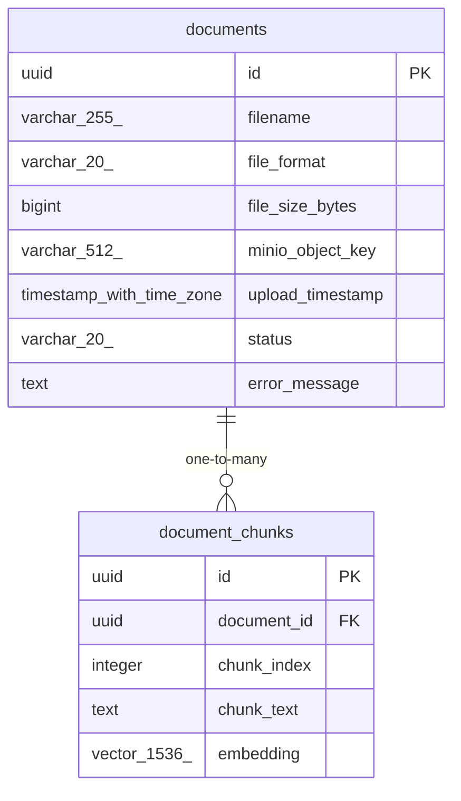

# Data Model

<!-- sdlc:auto:start entities -->
### documents

| Field | Type | PK | FK | Nullable |
|---|---|---|---|---|
| id | uuid | True | — | False |
| filename | varchar(255) | False | — | False |
| file_format | varchar(20) | False | — | False |
| file_size_bytes | bigint | False | — | False |
| minio_object_key | varchar(512) | False | — | False |
| upload_timestamp | timestamp with time zone | False | — | False |
| status | varchar(20) | False | — | False |
| error_message | text | False | — | True |

### document_chunks

| Field | Type | PK | FK | Nullable |
|---|---|---|---|---|
| id | uuid | True | — | False |
| document_id | uuid | False | documents.id | False |
| chunk_index | integer | False | — | False |
| chunk_text | text | False | — | False |
| embedding | vector(1536) | False | — | False |
<!-- sdlc:auto:end entities -->

<!-- sdlc:auto:start relationships -->
| Source | Target | Type |
|---|---|---|
| documents | document_chunks | one-to-many |
<!-- sdlc:auto:end relationships -->

<!-- sdlc:auto:start er-diagram -->

<!-- sdlc:auto:end er-diagram -->
