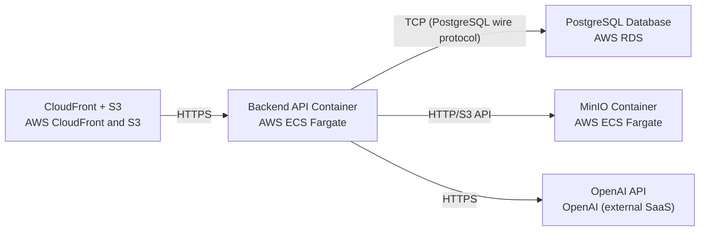

# Deployment Guide

> Maintained by QuorQ AI SDLC. Text between `sdlc:auto` markers is regenerated; anything outside them is yours and is kept.

<!-- sdlc:auto:start how-it-deploys -->
Pushes to `main` run `.github/workflows/deploy.yml`, which builds the API image (if there is a backend) and deploys the SPA to AWS Amplify. Commits touching only `docs/sdlc/**` don't deploy. Deployments can also be started from the platform's Deployment tab.
<!-- sdlc:auto:end how-it-deploys -->

<!-- sdlc:auto:start environments -->
| Name | Service | Runtime | Scaling | Environment |
|---|---|---|---|---|
| CloudFront + S3 | AWS CloudFront and S3 | Static hosting | CloudFront edge-cached, S3 automatically scales | dev |
| Backend API Container | AWS ECS Fargate | FastAPI 0.115 on Python 3.12 | Single task for pilot, autoscaling ready | dev |
| MinIO Container | AWS ECS Fargate | bitnamilegacy/minio:2024.10.13 | Single task with EBS-backed storage | dev |
| PostgreSQL Database | AWS RDS | PostgreSQL 16 with pgvector extension | Single db.t3.medium instance for pilot | dev |
| OpenAI API | OpenAI (external SaaS) | Cloud-hosted | Provider-managed | dev |
<!-- sdlc:auto:end environments -->

<!-- sdlc:auto:start live -->
_Not deployed yet._
<!-- sdlc:auto:end live -->

<!-- sdlc:auto:start topology -->

<!-- sdlc:auto:end topology -->
